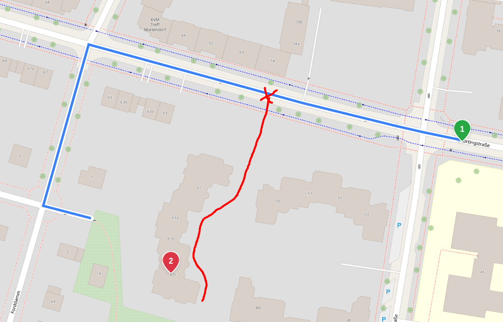

# Location `street` **BETA**

A common problem is that geocoders lack the data to return "navigable" points, i.e. how an address should be approached by car. Often we get a building's center coordinate as waypoint. And sometimes that's closer to another road than the building's address, see the example below:

Valhalla supports a location's `street` (see [API docs](https://valhalla.github.io/valhalla/api/route/api-reference/#locations)), against which it'll score the surrounding edges names within `street_radius` and use the highest scored edge (& its opposing) above `street_threshold` to initialize the expansion.

## Processing

1. **Collect candidates**: Collect the pool of edge candidates within `street_radius` if `street` is not empty. Note, the other hard filters apply for this pool too.
2. **Normalize names**: Decompose each name using `utf8proc` plus our extra table for additional decompositions; strip non-alphanumeric characters
3. **Convert to Trigrams**: Turn `street` & each road name into a collection of trigrams (single `uint64_t` with 3 x 21 bit), e.g. `Weserstr` -> `{"wes", "ese", "ser", "ers", "rst", "str"}`
4. **Calculate weights for `street` trigrams**: For each of the `street`'s trigrams, determine its score, which is proportional to its "inverse document frequency" in the whole pool. Rare trigrams have a higher weight than common ones. The idea is that trigrams of generics like "straße", "avenue" etc are then scored much lower and hardly contribute to the overall score, which makes it automatically adapt to each location.
5. **Score candidate names**: Each trigram in the pool gets scored against the `street`, by adding up the weights of the shared trigrams and dividing by the total weight of all `street` trigrams. `street` trigrams which aren't found in the pool lower the score significantly.
6. **Keep the best scored candidate**: We only keep the candidate with the highest score. If there's a tie of multiple edge candidates with the same score, e.g. several segments of the same street, the closest reachable one wins. If the best score is at least `street_threshold`, we use _only_ that edge and its opposing if no other hard or soft location filter applies. All other loki edge candidates move to the filtered edges.

## Known limitations

In the current state, the implementation all but expects the `street` from a geocoder with the same data source for road names.

Current limitations are:

- very little tolerance towards typos: typos are most likely "rare trigrams" which get scored highly on the wrong road names
- we ignore unreachable candidates, i.e. if none of the best scored edges has the minimum reachability specified for the location, the `street` is ignored
- refs like A1 are ignored
- not sure on script/locale support, only Latin, Greek & Cyrillic is known to work; others probably work, however, not Chinese & Japanese and cross-script (no transliteration applied, e.g. Cyrillic in `street`, Latin in data)
