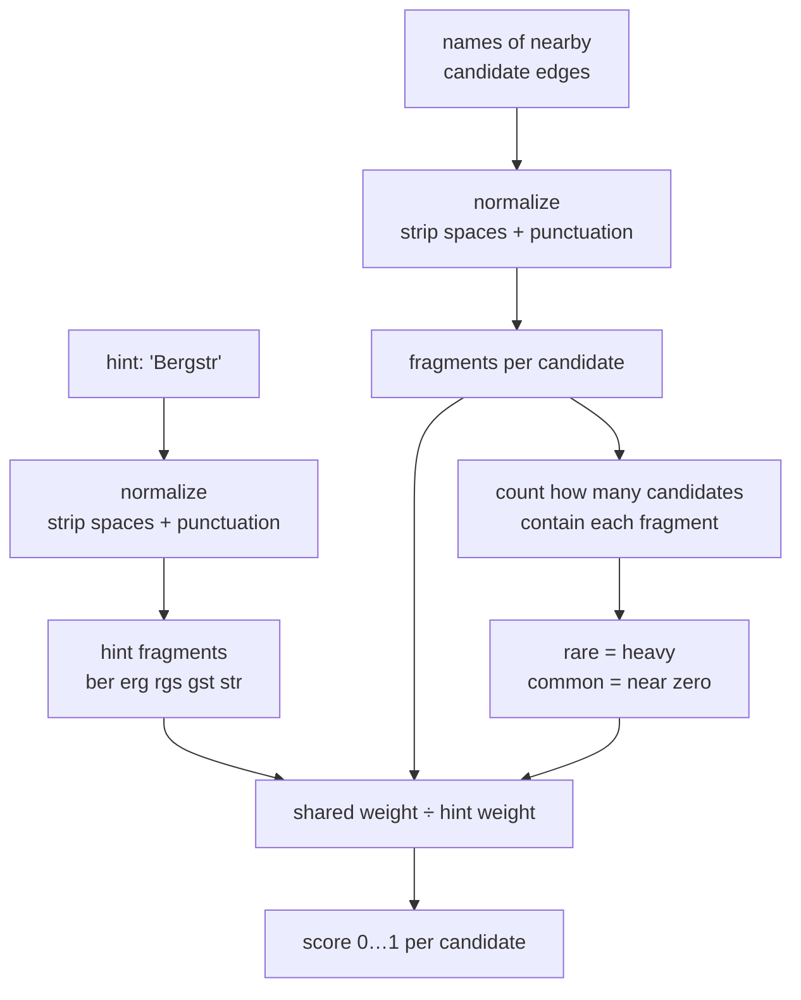

# street name hint — design notes

Companion to [geocoding_problem_description.md](geocoding_problem_description.md). The design and the
decisions taken on it; [scripts/geocoding_demo/](scripts/geocoding_demo/README.md) is the stdlib Python
prototype that measures them, one module per eventual C++ translation unit. Values below marked
*measured* come from that prototype on real `/locate` pools (Tübingen, Berlin-Neukölln).

## Framing

Not one string-similarity problem, three:

1. **Normalization** — make `Primus-Truber-Str` and `Primus Truber Straße` comparable at all.
2. **Weighting** — decide that `Truber` carries the signal and `Straße` carries almost none.
3. **Aggregation + integration** — turn a similarity into a decision that doesn't wreck the geometric
   correlation.

Plain Levenshtein on raw strings fails (2) outright and fails (1) badly: an abbreviation is a run of
deletions, so `Primus-Truber-Str` → `Primus-Truber-Straße` costs 4 edits on a 17-char string, while a
genuinely different street two blocks over (`Primus-Huber-Straße`) costs 1. Edit distance is a fine
*inner* primitive on a single token; it is the wrong *outer* one.

## 1. Normalization

NFKD decompose → strip combining marks → lowercase → transliterate the letters NFKD can't touch
(ß→ss, ø→o, ł→l, đ→d, þ→th, æ→ae, œ→oe) → punctuation (`- . ' ´ ,`) becomes space → collapse
whitespace.

German users type `Mueller`, `Müller` and `Muller` interchangeably. Fold ü→u *and* expand ue→u in a
second aggressive pass, scored with a penalty, tried only if the light pass misses threshold. Same for
oe/ae.

Applied to both sides, this alone resolves the hyphen half of the problem statement.

Decided: no ICU, no NFKD at runtime. Valhalla has neither, and NFKD wouldn't be enough anyway, since
`ß ø ł æ œ þ` don't decompose. The fold is a literal per-codepoint table, generated offline from NFKD
plus Unicode character names plus a short exception list. It covers 387 of the 401 letters in
U+00A0–U+024F, and the C++ side gets the same table as a `constexpr` array. Anything outside it
(Greek, Cyrillic, CJK) passes through unfolded.

### Runtime, not baked into tiles

Decided: normalize at query time, one function used on both the hint and the candidate names.

- **The normalizer will change.** Ship it, then discover `ł` isn't NFKD-decomposable, then add an alias.
  If normalized forms live in tiles, every fix is either a planet rebuild or — worse — a silent mismatch
  between a hint normalized by new code and tile strings normalized by an old function. A single shared
  call makes the invariant structural.
- **Works on every existing tileset.** No rebuild, no format change, no `TaggedValue`.
- **Cost is negligible.** Per-candidate, not per-edge — tens of short strings per request, against
  projection maths already running per candidate. There is no planet-scale multiplier.
- Precomputing trigram bags as bitsets is the only thing tile storage would genuinely buy, and it freezes
  the gram definition into the data too — the same versioning trap, one level deeper.

Implementation notes for later: normalize **lazily**, after the geometric/reachability filter, so
discarded candidates cost nothing. If profiling ever demands it, **memoize rather than serialize** — tile
text-list offsets are stable within a tile, so an offset→normalized cache beside the tile gets most of the
benefit with none of the format coupling.

## 2. Compounding and word order

`Hermannstraße` vs `Hermann Straße`, and `Via Roma` vs `Kossuth utca` vs `Atatürk Caddesi`, are the same
problem: the generic term can be prefixed, suffixed, or glued on. Romance/Slavic/Arabic prefix it;
Germanic/Turkic/Finno-Ugric/Chinese suffix it.

### Design A — gazetteer + token alignment

Ship ~150 street generics and abbreviations across ~15 languages. Split compound tokens on a known suffix,
canonicalize abbreviations to a generic ID, pull it into its own slot. Compare `core_tokens` by bipartite
matching over normalized Damerau-Levenshtein; score the generic separately at low weight.

Accurate and explainable, and the only thing that *truly* resolves `Str` → `Straße`. But it is a permanent
maintenance surface, it is language-detection-adjacent, and it has a tail that never ends.

### Design B — IDF-weighted character n-grams (chosen)

Strip all whitespace from both normalized strings, take character trigram bags, score by **containment
of the hint**: shared hint weight ÷ total hint weight, each gram weighted by rarity.

## 3. Design B in plain language

**A trigram is a 3-character sliding window.** `bergstrasse` → `ber, erg, rgs, gst, str, tra, ras, ass,
sse`. You now hold a bag of fragments instead of a string.

A bag has no order and no word boundaries, so two things fall out for free:

- **Compounding stops mattering.** Strip spaces first and `Hermann Straße` / `Hermannstraße` both become
  `hermannstrasse` — literally the same bag. No rule, no knowledge that German compounds.
- **Word order stops mattering.** `Via Roma` and `Roma Via` give nearly the same bag, so prefix-vs-suffix
  generics never come up.

**Comparing two bags:** count shared fragments, divide by the count in the *hint's* bag. That is what
makes abbreviations work — every fragment of `primustruberstr` also appears in `primustruberstrasse`, so
it scores 1.0 instead of being punished for the missing letters. Dividing by the *smaller* bag instead
would be wrong: `Truber Str` would then score 1.0 against the hint `Primus Truber Straße`.

### The problem with doing only that

Candidates near a German address: *Bergstraße, Burgstraße, Bahnhofstraße, Schulweg*. Hint `Bergstr` →
fragments `ber, erg, rgs, gst, str`.

| candidate | shared | plain score |
|---|---|---|
| Bergstraße | 5 of 5 | 1.00 ✅ |
| Burgstraße | 3 of 5 | 0.60 ⚠️ |
| Bahnhofstraße | 1 of 5 | 0.20 |

Burgstraße lands at 0.60 purely because both end in `-gstrasse`. The generic is loud and is drowning out
the one letter that distinguishes the streets.

### IDF is the volume knob

A fragment appearing in many nearby names tells you nothing; one appearing in a single name tells you
everything. Weight each fragment by its rarity **among the candidates currently being compared**.

| fragment | in how many | verdict | weight |
|---|---|---|---|
| `str`, `tra`, `ras`, `ass`, `sse` | 3 of 4 | everywhere, ignore | 0.29 |
| `rgs`, `gst` | 2 of 4 | mildly useful | 0.69 |
| `ber`, `erg`, `bur`, `urg`, `bah`… | 1 of 4 | the signal | 1.39 |

| candidate | plain | IDF-weighted |
|---|---|---|
| Bergstraße | 1.00 | **1.00** |
| Burgstraße | 0.60 | **0.38** |
| Bahnhofstraße | 0.20 | 0.07 |

The gap between right and wrong widens from 0.40 to 0.62. Nothing told the algorithm that *Straße* is a
street-type word — it inferred it from everything nearby having it.

Concretely, with N = distinct normalized names in the corpus:

```
weight(g) = ln(N / max(df(g), 1))
```

A hint gram no nearby name contains gets the maximum weight. Dropping it instead would let `Mozartstr`
score 1.0 against every `-straße` in the pool. The table above is this formula at N=4, and the prototype
asserts the 1.00 / 0.38 / 0.07 on every run.



### Why this fits the 80% goal

- **No language tables.** Common fragments come from `caddesi` in Turkey and `calle` in Spain. Reweights
  itself per location, nothing to maintain, no country detection.
- **Small.** Normalize, slide a window, count, intersect. No alignment, no dynamic programming.

### Caveats

Each one turned into a rule in §4.

- **Typos are a cliff on short cores, not a dip.** *Measured:* the rare grams sit in the core, which is
  short, so `Dobelrstr` (one transposition) keeps 3 of 7 grams and scores 0.23, tied with a wrong
  street. `Doblr Strasse` (one dropped letter) scores 0.57. Both are below τ. → edit-distance retry on
  the core.
- **A ratio cannot measure how much evidence there is.** *Measured:* `Str` alone scores 1.0 against every
  `-straße`, because its only gram is common, but common everywhere. → evidence floor.
- **A hint can sit inside a longer name.** *Measured:* `leinstr` shares all but `lei` with
  `silbersteinstr`, so Silbersteinstraße scores 0.68 and Leinestraße, which lost `ins`/`nst` to the
  dropped `e`, only 0.61. Containment ignores the candidate's surplus by design. → weak surplus term.
  Anchoring grams at the start of the name or token (pg_trgm-style padding) was tried and changed
  nothing.
- **Cannot separate `Hauptweg` from `Hauptstraße` on principle** — both generics get down-weighted to
  nothing, yet they are different streets that frequently coexist in one village. → generics list and
  mismatch penalty. The edit-distance retry makes this sharper: with the generic removed, both cores
  are `haupt`.
- **Rarity needs enough candidates.** Fewer than two distinct names → every weight is 0 → no score.

**Chosen:** Design B, plus a generics list (prefix / suffix / glued forms, ~80 across de, nl,
Scandinavian, en, fr, it, es, pt, pl, tr, hu, cz) for the mismatch penalty and for cutting the core out,
plus ~40 position-aware abbreviations (`st` closing a name is street, `pl` is place/platz/plac/plaza).
Abbreviations that truncate (`str`, `ave`) need no entry, since containment covers them. Design A stays
unbuilt.

## 4. Aggregation details

These matter more than the choice of similarity function. Per name, in this order:

1. **Ref regime.** A hint that looks like a ref (one to three letters, digits, at most one trailing
   letter: `B28`, `L 1208`, `US101`) is matched near-exactly on the light form, giving 1.0 or 0.0, and
   nothing else runs. A street hint never scores a ref name. Fuzzy matching on 3-char alphanumerics is
   meaningless.
2. **Evidence floor.** The hint's total gram weight must reach `1.5 · ln(N)`, roughly 1.5 grams of maximal
   rarity, or the hint scores nothing anywhere. *Measured:* `Str` carries 0.45 against a floor of 7.6 in
   Tübingen.
3. **Asymmetric miss penalty.** Hint grams absent from the candidate are strong negative evidence: they
   are the containment denominator. Candidate grams absent from the hint are weak evidence (humans drop
   words), so they cost only `× (1 − γ · uncovered share of the candidate's weight)`. Generic grams are
   cheap, so abbreviations barely pay, while `silberst` or `gersten` does. *Measured:* γ = 0.3. At 0.15,
   Silbersteinstraße still cleared τ for `leinstr`. At 0.5, prefix-word names like `Obere Schillerstraße`
   start to suffer (0.93 → 0.77).
4. **Retries, only below τ**, best one wins:
   - the aggressive pass × β (0.9);
   - OSA edit distance (a transposition counts as one edit) between the **cores**, meaning the name with
     its generic removed, × 0.85. *Measured:* `Dobelrstr` and `Doblr Strasse` both reach 0.71.
5. **Generic disagreement is not free.** If both sides carry a generic and they share none, × 0.6.
   *Measured:* `Hauptweg` vs Hauptstraße 0.51, while Hauptweg itself scores 1.0.

Around that:

- **Score against every name an edge carries** and take the max: `name`, the `name:xx` variants, and `ref`.
- **Expand leading and closing abbreviations** into extra hint variants (`Main Rd` → `Main Road`) and score
  the best variant.
- **Strip trailing house numbers** into a discarded slot. On a comma, use the first component; the rest is
  usually a city, optionally checkable against admin data.

## 5. Integration

Decided: a **soft filter**, bounded by a hint radius. The problem statement asks for "matching roads are
the ones we correlate to".

```
effective_distance = distance × (1 − α · name_score)      α = 0.8
```

Scaling distances alone was the first idea and is not enough. It bounds a hint to `1/(1−α)` = 5× the
closest edge's distance. *Measured:* `Pfleghofstr` in Tübingen is 27.3 m away against 4.5 m for the
closest edge. Its effective distance is 5.7 m, so the hint loses exactly in the case it exists for:
an address point sitting nearer a side street.

How it works:

- **Hint radius** (default 100 m, overridable per location, bounded by service limits). Loki keeps only
  the closest edge at `radius=0`, discarding the rest during the bin search. So when a hint is present,
  it has to collect everything within the hint radius instead. The names inside that radius are the IDF
  corpus, and the radius is the cap on how far a hint can move the correlation.
- **Hint used** iff some edge within the hint radius scores ≥ τ (0.6). If none does, the output is exactly
  today's: the stated soft-filter fallback.
- **When it is used:**
  - Matching edges (score ≥ τ) become `edges`, with their distance replaced by the effective distance.
    Loki's usual rule then runs on them: everything inside the location radius, otherwise the closest
    edge and its ties.
  - What loki would have picked without the hint becomes `filtered_edges`. That is thor's existing
    fallback, retried with a `+3600 + worst kept` penalty only when `edges` find no route.
  - α therefore only orders matching edges among themselves. A perfect match 90 m away still loses to a
    decent one 20 m away.
- **Thor is unchanged.** It already turns `PathEdge.distance` into `10·d²` (minus the minimum, capped at
  43200 for auto, which saturates at ~66 m) and already handles `filtered_edges`. The whole change is one
  hook in `src/loki/search.cc`: collect within the hint radius during the bin search, then score and
  split in `finalize()`.
- **Surface whether the hint was used** in the response. Silent fallback is much harder to debug than a
  flag.

*Measured:* `Pfleghofstr 5, Tübingen` moves the correlation 22.8 m, and `Leinestr` in Neukölln moves it
39.6 m. Hints with no match nearby (`Mozartstr`, or `Hegelstr` with Hegelstraße outside 100 m) change
nothing.

Nothing here touches tiles or the graph — query-time only, in the correlation step.

## 6. Validation

Generate the corpus from the tileset itself: take real OSM names and apply synthetic human corruptions —
abbreviate the generic, strip diacritics, split the compound, transpose two letters, drop a token. Measure
recall@1 against the true edge plus the false-positive rate against names from the *same* region.

That tunes τ, α, β, γ, the retry discounts and the evidence floor on something real, and is the
difference between "80% solution" and "80% solution we can prove". Every value above is a hand-picked
guess until then. The prototype's fixtures only pin individual cases.

## Decided

- **Rarity corpus is local**: the distinct names within the hint radius. A fixed default radius keeps
  scores reproducible. No shipped static table.
- **Short-name fallback** has become the core edit-distance retry, for every length, triggered by
  missing τ rather than by a length cutoff.

## Open questions

- **Location radius on effective or raw distance.** Applying it to the effective distance (what "the
  hook replaces the distance" implies) widens the caller's `radius` by up to `1/(1−αs)` for matching
  edges.
- **Compounds of the hinted name.** `Muehlstr` still clears τ on Gerstenmühlstraße (0.74 vs 0.88). If
  both are within the hint radius, the closer one wins.
- **Typo grams count as maximum evidence.** A gram no nearby name contains gets the top weight, so a
  typo *raises* the evidence total. That's harmless so far, but the floor measures novelty as well as
  rarity.
- **German article prefixes** (`Am`, `An der`, `Im`, `Zum`) are not generics, so they stay in the core.
- **Non-Latin scripts.** Normalized-exact and trigram scoring still function; only the alias/generics
  tables don't apply. Probably acceptable for the stated 80% target.
